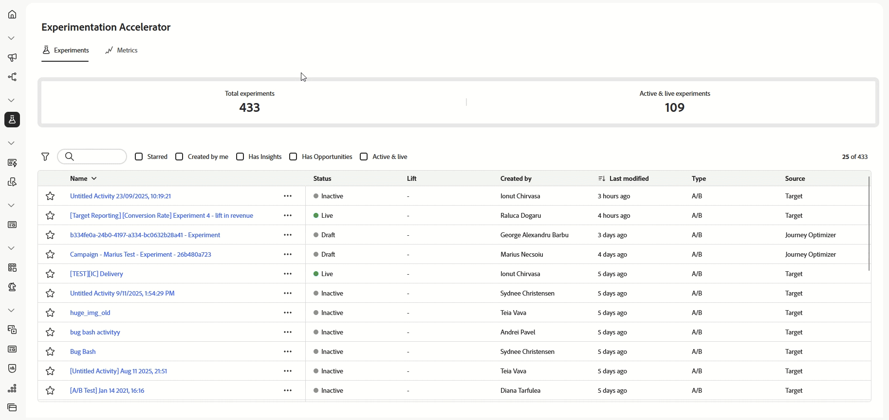

# Experimentation Accelerator de Journey Optimizer

>[!AVAILABILITY]
>
>**Journey Optimizer Experimentation Accelerator** nécessite une licence payante pour les clients et clientes, et s’intègre facilement à Adobe Target ou Adobe Journey Optimizer.

**Journey Optimizer Experimentation Accelerator** est un outil puissant conçu pour optimiser et améliorer le processus d’expérimentation. En s’intégrant à Adobe Target et Adobe Journey Optimizer, il fournit une plateforme centralisée pour gérer, analyser et optimiser les expériences. En utilisant les informations basées sur l’IA et les tests adaptatifs, Journey Optimizer Experimentation Accelerator vous permet de prendre des décisions axées sur les données, d’améliorer les stratégies marketing et de générer des résultats mesurables.

Il offre les principaux avantages suivants :

* **Expérimentation plus rapide** : exécutez des tests adaptatifs continus avec des modèles qui s’ajustent au fil du temps.
* **Plateforme unifiée** : gérez toutes les expérimentations concernant Adobe Target et Journey Optimizer au même endroit.
* **Informations basées sur l’IA** : mettez automatiquement en évidence les résultats clés, les facteurs de performances et les nouvelles opportunités.
* **Ciblage plus intelligent** : utilisez des données comportementales et de contenu pour donner la priorité aux expériences à fort impact.
* **Surveillance des KPI** : effectuez le suivi de mesures telles que l’impact sur les KPI et le degré de confiance dans toutes les expériences.
* **Collaboration fluide** : partagez facilement les résultats et gérez les rôles d’équipe avec des alertes en temps réel.

<table style="table-layout:fixed">
<tr style="border: 0; text-align: center;">
<td> <a href="../start/experiment-accelerator-access.md">Commencer avec Journey Optimizer Experimentation Accelerator</a></td>
<td> <a href="../start/experiment-accelerator-best-practices.md">Bonnes pratiques relatives à Journey Optimizer Experimentation Accelerator</a></td>
<td> <a href="../track/experiment-accelerator-monitor.md">Suivre et surveiller les performances de vos expériences</a></td>
</tr>
</table>
