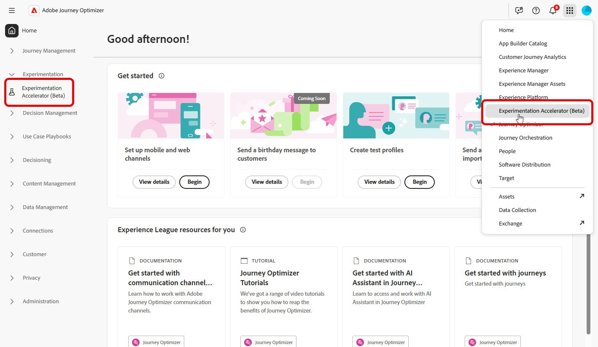
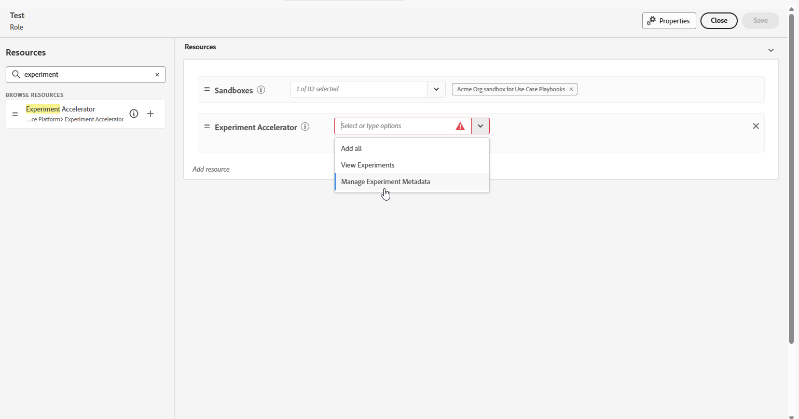
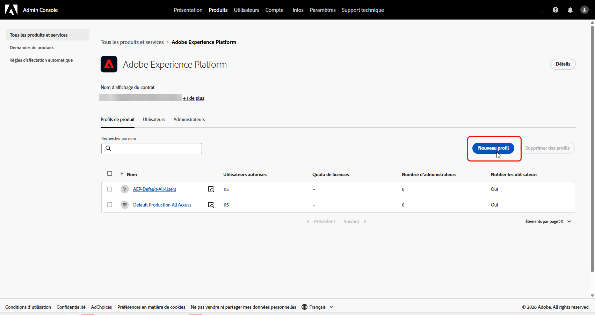
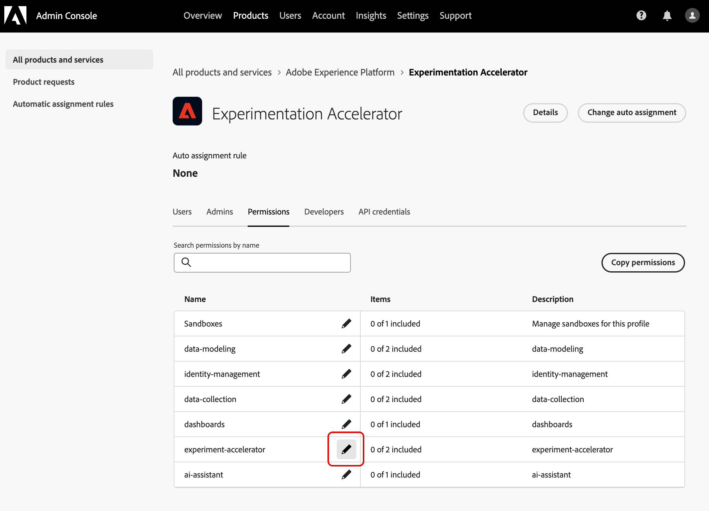
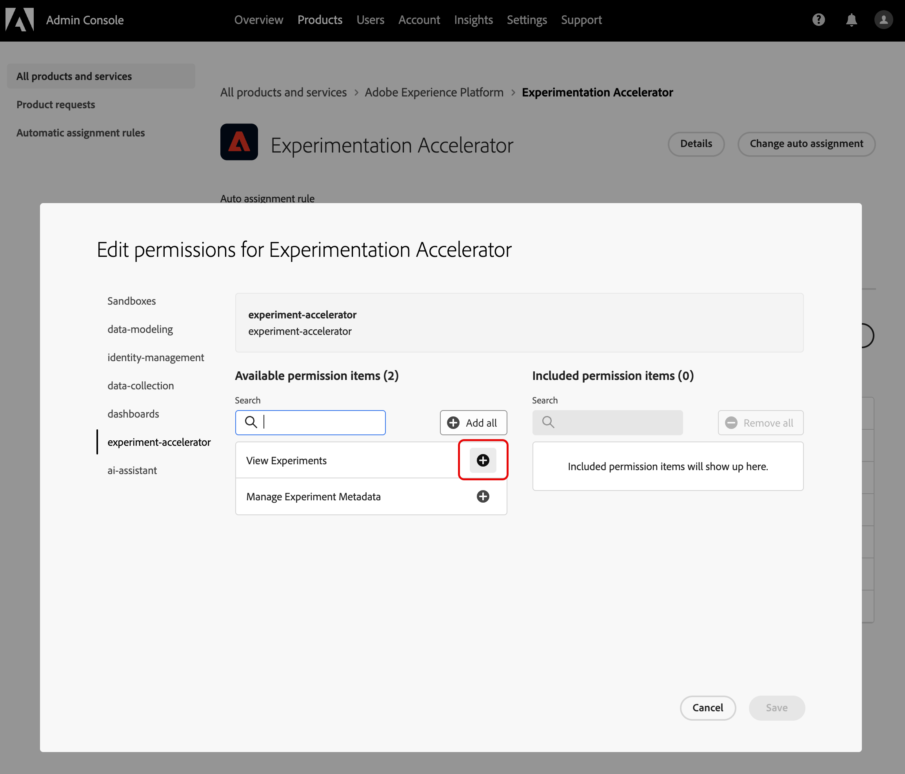
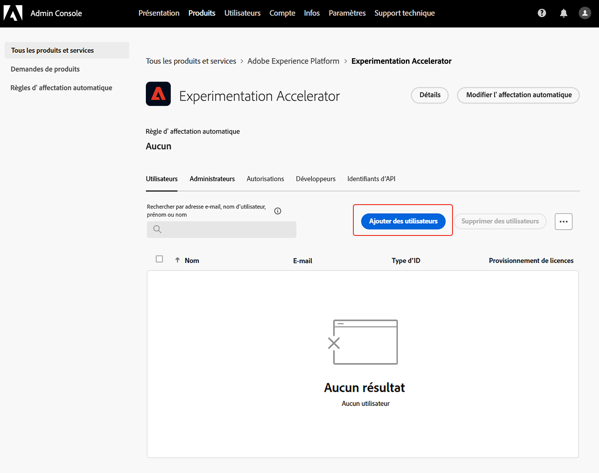

# Accéder à Journey Optimizer Experimentation Accelerator

Après avoir [créé et configuré votre expérience](https://experienceleague.adobe.com/fr/docs/journey-optimizer/using/content-management/content-experiment/content-experiment) et envoyé vos campagnes ou vos parcours à vos profils, vous pouvez accéder à **[!UICONTROL Journey Optimizer Experimentation Accelerator]** pour observer plus en détail les performances de votre expérience.

Vous pouvez accéder à **[!UICONTROL Journey Optimizer Experimentation Accelerator]** à partir du menu de gauche de la liste déroulante [!UICONTROL Expérience] ou via le sélecteur d’applications. Notez que les utilisateurs et les utilisatrices qui ne disposent que d’une licence Target peuvent y accéder uniquement par le biais du sélecteur d’applications.

Les expériences disponibles dépendent de votre configuration :

* **Pour les utilisateurs et les utilisatrices d’Adobe Journey Optimizer** : les expériences configurées dans le sandbox activé de votre organisation sont automatiquement incluses.

* **Pour les utilisateurs et les utilisatrices d’Adobe Target avec Journey Optimizer** : toutes les activités A/B dans Target apparaissent dans **[!UICONTROL Journey Optimizer Experimentation Accelerator]**, dans le sandbox de production de Journey Optimizer.

* **Pour les utilisateurs et les utilisatrices d’Adobe Target uniquement** : toutes les activités A/B de votre organisation Target sont incluses dans le sandbox de production de Journey Optimizer.

Pour utiliser **[!UICONTROL Journey Optimizer Experimentation Accelerator]**, vous devez accéder au sandbox et suivre des autorisations correspondantes :

* **[!UICONTROL Afficher les expériences]**
* **[!UICONTROL Gérer les métadonnées d’expérience]**

+++ Découvrez comment attribuer des autorisations liées aux expériences avec une licence Adobe Experience Platform ou Adobe Journey Optimizer.

1. Dans le produit **[!DNL Permissions]**, accédez à l’onglet **[!UICONTROL Rôles]** et sélectionnez le **[!UICONTROL Rôle]** de votre choix.

1. Cliquez sur **[!UICONTROL Modifier]** pour modifier les autorisations.

1. Ajoutez la ressource **[!UICONTROL Accélérateur d’expériences]**, puis sélectionnez **[!UICONTROL Afficher les expériences]** et/ou **[!UICONTROL Gérer les métadonnées d’expérience]** dans le menu déroulant.

   

1. Cliquez sur **[!UICONTROL Enregistrer]** pour appliquer vos modifications.

Les autorisations des personnes déjà affectées à ce rôle seront automatiquement mises à jour.

Pour attribuer ce rôle à de nouvelles personnes, procédez comme suit :

1. Accédez à l’onglet **[!UICONTROL Utilisateurs et utilisatrices]** dans votre tableau de bord Rôles et cliquez sur **[!UICONTROL Ajouter des utilisateurs et des utilisatrices]**.

1. Saisissez le nom de la personne, son adresse e-mail ou choisissez dans la liste, puis cliquez sur **[!UICONTROL Enregistrer]**.

   Si le profil de l’utilisateur ou de l’utilisatrice n’a pas été créé auparavant, consultez [cette documentation](https://experienceleague.adobe.com/fr/docs/experience-platform/access-control/abac/permissions-ui/users).

La personne recevra un e-mail avec des instructions pour accéder à votre instance.

+++

 

+++ Découvrez comment attribuer des autorisations liées aux expériences avec une licence Adobe Target.

1. Ouvrez **[Admin Console](http://adminconsole.adobe.com/)**.

1. Dans **[!UICONTROL Produits]**, choisissez **[!UICONTROL Adobe Experience Platform]**.

1. Cliquez sur **[!UICONTROL Nouveau profil]**.

   

1. Saisissez un **[!UICONTROL nom]** et une **[!UICONTROL description]** pour le profil, puis cliquez sur **[!UICONTROL Enregistrer]**.

1. Ouvrez le **[!UICONTROL profil]** que vous venez de créer et accédez à l’onglet **[!UICONTROL Autorisations]**.

1. Cliquez sur  en regard de l’autorisation **[!UICONTROL expérimentation-acceleration]**.

   

1. Ajoutez les autorisations requises pour ce profil, telles que **[!UICONTROL Afficher les expériences]** et **[!UICONTROL Gérer les métadonnées d’expérience]**, puis cliquez sur **[!UICONTROL Enregistrer]**.

   >[!TIP]
   >
   > Créez des profils distincts lorsque les utilisateurs et utilisatrices ont besoin de différents niveaux d’accès. Par exemple, créez un profil **[!UICONTROL Observateur ou observatrice Experiment Accelerator]** avec uniquement **[!UICONTROL Afficher les expériences]**, et un profil **[!UICONTROL Éditeur ou éditrice Experimentation Accelerator]** avec **[!UICONTROL Afficher les expériences]** et **[!UICONTROL Gérer les métadonnées d’expérience]**.

   

1. Dans l’onglet **[!UICONTROL Autorisations]**, sélectionnez **[!UICONTROL Sandbox]**.

1. Ajoutez les sandbox dans lesquels les utilisateurs et utilisatrices doivent pouvoir utiliser Journey Optimizer Experimentation Accelerator, puis cliquez sur **[!UICONTROL Enregistrer]**.

1. Dans l’onglet **[!UICONTROL Utilisateurs et utilisatrices]**, cliquez sur **[!UICONTROL Ajouter des utilisateurs et utilisatrices]**.

   

1. Ajoutez les utilisateurs et utilisatrices qui doivent bénéficier de cet accès, puis cliquez sur **[!UICONTROL Enregistrer]**.

Les utilisateurs et utilisatrices ajoutés à ce profil peuvent désormais accéder à Journey Optimizer Experimentation Accelerator à partir du sélecteur d’applications.

+++

<!--
table style="table-layout:fixed"><tr style="border: 0;">
<td>

<strong><a href="experiment-accelerator-overview.md">Overview</a></strong>

</td>
<td>

<strong><a href="experiment-accelerator-monitor.md">Experiments</a></strong>

</td>
<td>

<strong><a href="experiment-accelerator-metrics.md">Metrics</a></strong>

</td>
</tr></table
-->
