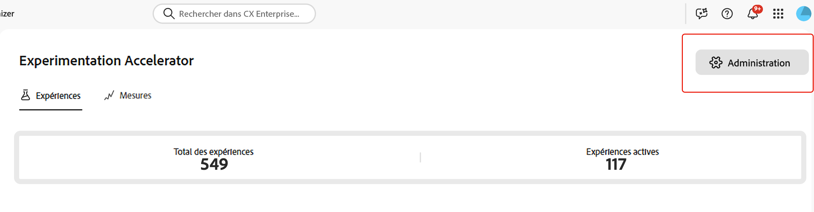
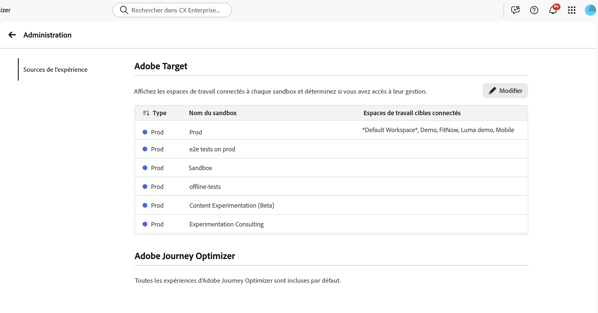
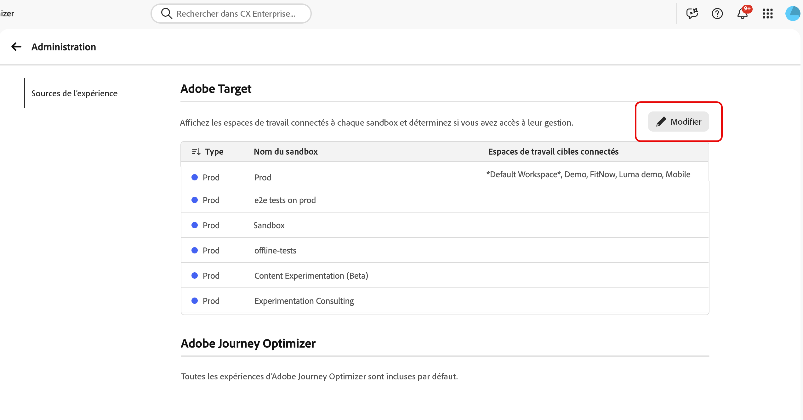
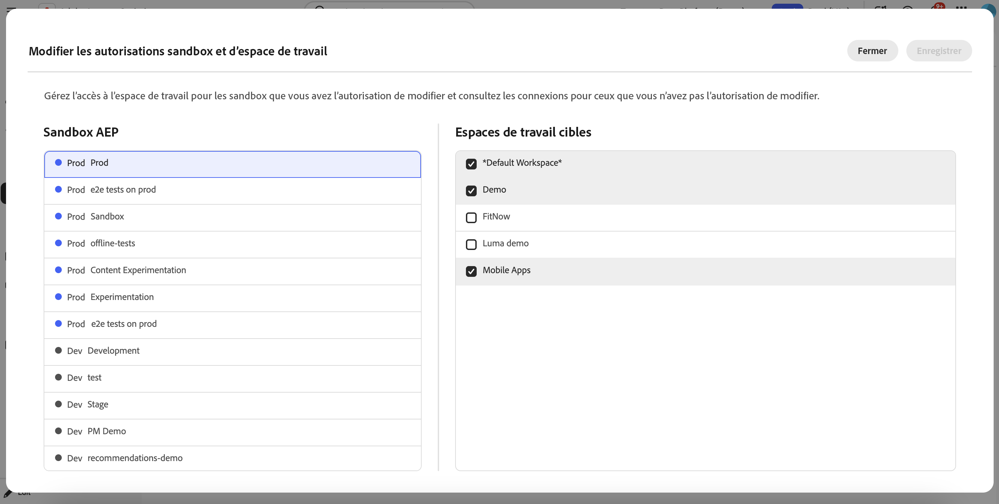

# Intégration de [!DNL Target] à Experimentation Accelerator

Experimentation Accelerator permet à l’équipe d’administration de gérer l’organisation et l’affichage des activités de l’espace de travail [!DNL Adobe Target] dans l’application.En mappant chaque espace de travail [!DNL Target] au sandbox Experimentation Accelerator approprié, les équipes peuvent afficher les expériences [!DNL Adobe Target] et [!DNL Adobe Journey Optimizer] à un seul endroit.

➡️ [En savoir plus sur Adobe Experimentation Accelerator](https://experienceleague.adobe.com/fr/docs/experimentation-accelerator/using/overview)

## Avant de commencer

Avant de configurer des affectations de sandbox, vérifiez que vous disposez des autorisations requises.Pour accéder à **[!UICONTROL Administration]** dans Experimentation Accelerator, vous devez disposer de l’autorisation **[!UICONTROL Gérer la configuration]**.

Pour attribuer des espaces de travail [!DNL Target] aux sandbox, vous devez remplir les deux conditions :

* Titulaire de l’autorisation **[!UICONTROL Gérer la configuration]** dans Experimentation Accelerator.
* Titulaire du rôle d’administration de produit [!DNL Target].

## Configurer l’affectation de sandbox pour les espaces de travail [!DNL Target]

Avant d’affecter des espaces de travail, notez que l’espace de travail [!DNL Target] ne peut être affecté qu’à un seul sandbox afin d’éviter les entrées en double pour le même test.

Pour choisir le sandbox dans lequel chaque espace de travail [!DNL Target] s’affiche :

1. Dans Experimentation Accelerator, accédez à **[!UICONTROL Administration]**.

   

1. Consultez le tableau des affectations actuelles de l’espace de travail [!DNL Target] au sandbox.

   

1. Cliquez sur **[!UICONTROL Modifier]**.

   

1. Pour chaque sandbox, attribuez les espaces de travail [!DNL Target] appropriés.

   

1. Cliquez sur **[!UICONTROL Enregistrer]** pour appliquer les changements.

Une fois la connexion initiale créée pour un espace de travail [!DNL Target], patientez jusqu’à 30 minutes pour que les mises à jour soient prises en compte dans le système.
